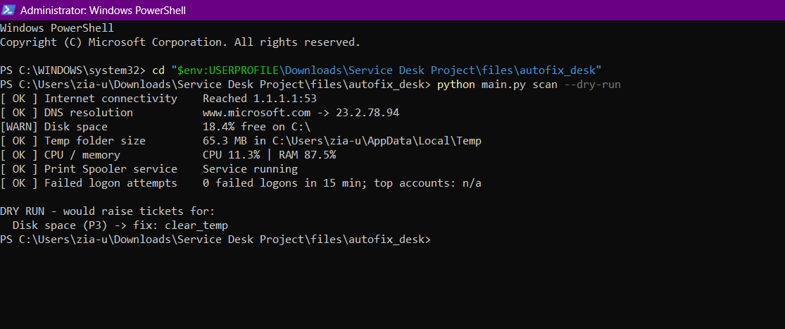
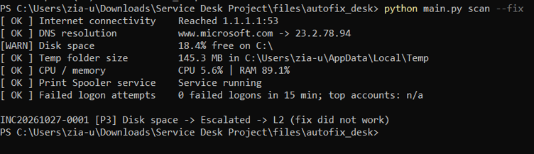
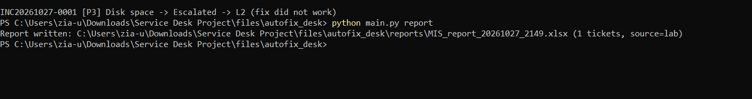
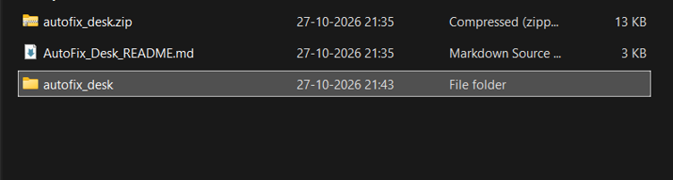
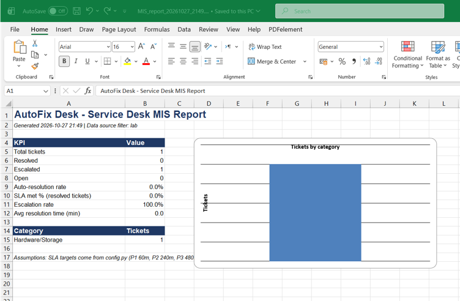

# AutoFix Desk: L1 IT Service Desk Automation & Security Triage Toolkit

> 📄 **[Read the Full Project Documentation & Execution Guide (Google Docs)](https://docs.google.com/document/d/14d4OM-4omVCinOZvEoUiBytoJq0dk-s5kzW77GsK7Zg/edit?usp=drivesdk)**

---

## 🛠️ Overview
**AutoFix Desk** is a Python and PowerShell-driven toolkit designed to replicate enterprise Tier 1 (L1) Service Desk operations. It automatically diagnoses system health, applies remediation scripts, logs tickets into a database, escalates unresolved issues to L2 support, and routes security anomalies (failed logons) to a SOC queue.

---

## 📸 Execution Screenshots & Demonstration

### 1. Health Diagnostic Scan (Dry Run)
*Running system diagnostic checks across connectivity, DNS, disk space, CPU/RAM, and Windows Event Logs.*


### 2. Live Auto-Fix Execution & L2 Escalation
*Executing auto-fix actions, detecting unresolvable low disk space, and automatically escalating INC20261027-0001 to L2.*


### 3. Automated MIS Report Generation
*Compiling incident statistics into a daily Excel report.*


### 4. Workspace Directory Structure
*Extracted project scripts, database file, and documentation files.*


### 5. Excel MIS Dashboard Output
*Management dashboard displaying ticket KPIs, escalation rates, and visual category breakdown.*


---

## 🎯 Key Features
* **Automated System Diagnostics:** Checks network connectivity, DNS, disk space, temp folder sizes, CPU/RAM usage, and print spooler status.
* **Auto-Remediation:** Automatically flushes DNS, clears temporary folders, and restarts failed services.
* **Security Event Monitoring:** Scans Windows Security Event Logs (Event ID 4625) for failed logon attempts and routes suspicious activity to a **SOC queue**.
* **Database & SLA Ticketing:** Logs structured incident records into SQLite with priority tagging (P1-P4) and SLA target calculations.
* **Daily MIS Reporting:** Uses `pandas` and `openpyxl` to produce automated Excel reporting dashboards.

---

## 🚀 Quick Start & Usage

```powershell
# Install required Python dependencies
pip install -r requirements.txt

# Run diagnostic scan (Dry-Run mode)
python main.py scan --dry-run

# Run diagnostic scan and execute auto-fixes
python main.py scan --fix

# Generate daily Excel MIS report
python main.py report
